# Nrf1 proteomics

_Proteomics experiments and reproducible data analysis_

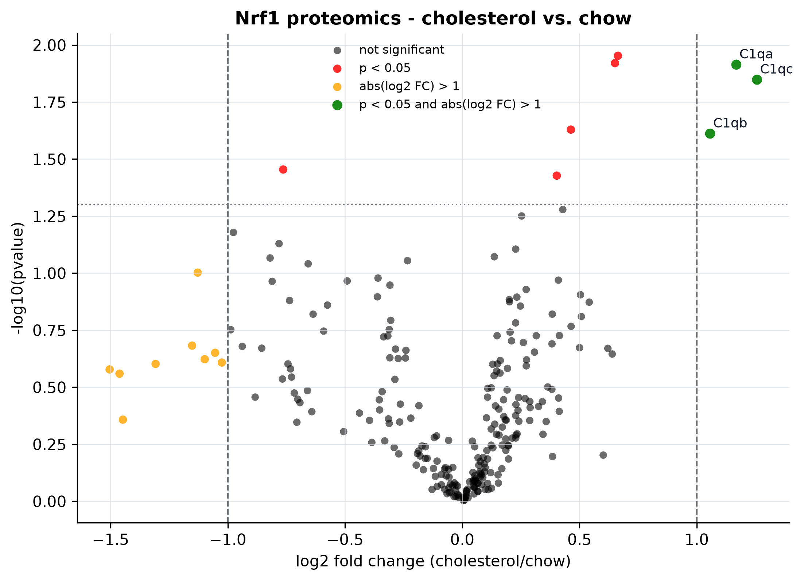

## Quickstart

Install [Hatch](https://hatch.pypa.io/latest/), then run the analysis from this directory.

```sh
hatch run analyze && hatch run plot
```

## Description

This repository contains data and analyses from a scientific experiment. The goal of this experiment was to identify a [molecular complex](https://en.wikipedia.org/wiki/Protein_complex) associated with [Nrf1](https://en.wikipedia.org/wiki/NFE2L1) (_NFE2L1_, not to be confused with Nuclear Respiratory Factor 1).

Nrf1 was selected for study because it resides on the surface of a [cellular organelle](https://en.wikipedia.org/wiki/Organelle) called the [Endoplasmic Reticulum](https://en.wikipedia.org/wiki/Endoplasmic_reticulum) (ER). The ER is involved in [metabolism](https://en.wikipedia.org/wiki/Metabolism). Cholesterol metabolism occurs at the ER and is particularly important in the liver, where cholesterol is metabolized and prepared for excretion. Some preliminary evidence suggested that Nrf1 might mediate cholesterol metabolism independently from its known function as a genetic transcription factor in the nucleus.

The hypothesis was that a complex of other proteins interacts with Nrf1 to mediate its response to cholesterol at the ER. The hypothesis was tested with [proteomics](https://en.wikipedia.org/wiki/Proteomics), which identifies all possible proteins in a sample with a technique called [mass spectrometry](https://en.wikipedia.org/wiki/Mass_spectrometry).

## Methods

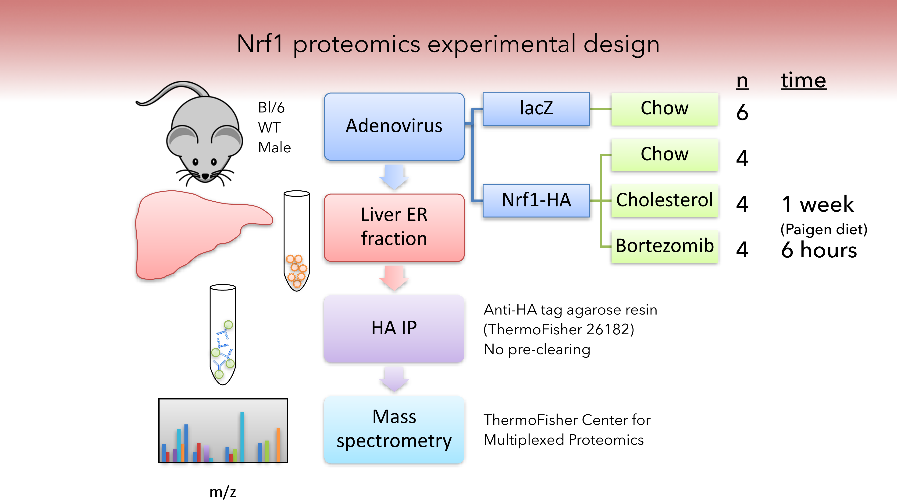

### Adenovirus

A tagged form of Nrf1 was used to study the Nrf1 protein complex in the context of liver tissue. A tag is a small number of additional amino acids used to more easily isolate and analyze the protein. A C-terminal HA tag (`YPYDVPDYA`) was used.

An [adenoviral vector](https://en.wikipedia.org/wiki/Viral_vector) was used to introduce the HA-tagged Nrf1 gene into mouse liver. The genetic material carried by the virus is incorporated into the mouse genome, and the protein is then produced by liver cells. A lacZ adenovirus was used as a negative control, which is a gene in the lac operon that encodes the beta-galactosidase protein.

Mice were handled in compliance with all ethical guidelines.

### Diets and treatments

The mice were fed either their standard chow diet or a Paigen diet which contains additional ingredients to promote accumulation of cholesterol in the liver. A group of mice also received treatment with the drug Bortezomib as a positive control for Nrf1 activation. Bortezomib is a pharmaceutical compound known to activate the genetic transcriptional functions of Nrf1 by inhibiting the [proteasome](https://en.wikipedia.org/wiki/Proteasome).

### Liver ER fraction and HA IP

The microsomal fraction (containing ER, where Nrf1 resides) was enriched from mouse liver lysates[^cox].

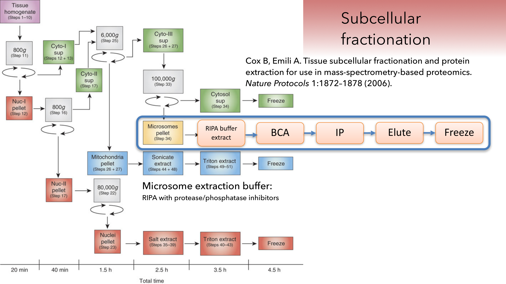

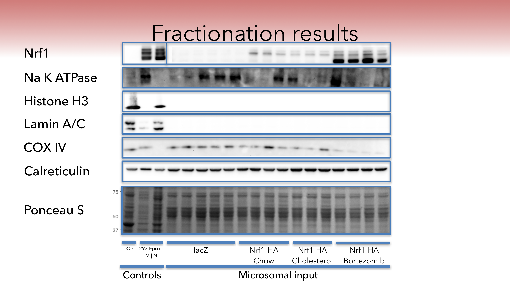

The Western blots display protein markers of different [cellular compartments](https://en.wikipedia.org/wiki/Cellular_compartment):

- Na K ATPase is a plasma membrane protein.
- Histone H3 is a nuclear protein that interacts with DNA.
- Lamin A/C are nuclear membrane proteins.
- COX IV is a mitochondrial protein.
- Calreticulin is an ER protein.
- Ponceau S is a total protein stain, used to show equal loading in all lanes.

The three lanes on the left are control samples:

- Lane 1: Nrf1 knockout mouse embryonic fibroblast ("KO" MEF) whole cell lysate. Negative control for presence of Nrf1.
- Lanes 2-3: HEK-293 cells ("293") are a commonly used immortalized human cell line (the cells continuously grow and divide in the lab). HEK-293 cells were used in this experiment as controls for Nrf1 and cellular compartments, and to evaluate antibody reactivity with human and mouse samples. The cells stably expressed Nrf1-HA, were treated with Epoxomycin ("Epoxo") to activate Nrf1, and were fractionated into microsomal ("M") or nuclear ("N") fractions. There is less total protein in the microsomal fraction (lane 2), because HEK-293 cells only yield small amounts of ER, but it is still useful as a qualitative comparison.

Nrf1 was measured, and is shown in the top row. As expected, samples from mice given the adenovirus had more Nrf1. The controls on the left were present on the same Western blot as the microsomal input samples, but a separate image from a shorter blot development exposure is shown because of the extremely strong signal.

**The Western blots demonstrate that the samples are enriched in microsomal proteins, and essentially free of nuclear proteins, but retain proteins from other membrane fractions.**

### Immunoprecipitation

Immediately after enriching the samples for the microsomal fraction, Nrf1 was isolated by immunoprecipitation (IP) for the HA tag. Standard reagents and procedures from ThermoFisher were used.

Further details can be found in the IP protocol and electronic lab notebook entry in the [supplementary data](#supplementary-data).

### Mass spectrometry

A proteomics core facility, the ThermoFisher Center for Multiplexed Proteomics, performed quantitative multiplexed proteomic mass spectrometry analysis on the liver samples. The combination of immunoprecipitation (a type of affinity purification) and mass spectrometry is referred to as affinity purification-mass spectrometry (AP-MS).

Samples were provided to the proteomics core in IP elution buffer.

1. Gel
   - The proteomics core performed a brief gel cleanup before mass spectrometry. They claimed this was helpful because the gels are agnostic to the elution buffer used to obtain the sample. However, a high protein concentration is required because of the small gel loading volume.
   - After mass tagging, they did a 3 hour column separation prior to MS.
   - If samples are divided among multiple runs (as these were), they include an internal "mix" standard for comparison. This is basically a small amount (5 uL) of all the samples mixed together.
   - 30 uL of each sample was then loaded into a 10% Bis-Tris gel and run at 120V for 12 minutes.
   - Gels were stained for 2 hours with Coomassie and destained overnight in water.
   - Additional gels were run and stained with the remaining sample.
   - Gel bands were cut out, destained, reduced and alkylated.
2. Enzyme digestion
   - In-gel trypsin digestion was performed.
3. Tandem Mass Tagging
   - Tandem Mass Tags (TMTs) were used to label primary amine groups. Ten different tags are available, allowing ten samples in the same mass spectrometry run. The tags are isobaric, meaning that they elute at the same time during LC, and have the same mass during MS1 acquisition, but after MS2 peptide sequencing, they fragment into unique ion masses during MS3 reporter ion quantification.
4. Mass spectrometry
   - Peptides were resuspended in 5% acetonitrile, 5% formic acid.
   - Peptides were separated using a gradient of 6 to 28% acetonitrile in 0.125% formic acid over 180 minutes.
   - Half of the sample was shot on an Orbitrap fusion tribrid mass spectrometer.

Further details can be found in the mass spectrometry protocol and electronic lab notebook entry in the [supplementary data](#supplementary-data).

### Data analysis

#### Proteomics core

At the proteomics core:

1. MS2 spectra were searched using the SEQUEST algorithm against a Uniprot composite database derived from the mouse proteome containing its reversed complement and known contaminants.
2. Peptide spectral matches were filtered to a 1% false discovery rate (FDR) using the target-decoy strategy, for determination of incorrectly identified proteins, combined with linear discriminant analysis.
3. Proteins were quantified only from peptides with a summed signal to noise (SN) threshold of at least 200 and MS2 isolation specificity of 0.5, and do not include contaminants or reverse hits.
4. Results were provided by the core facility in a Microsoft Excel workbook containing peptide counts (not sure if they are unique or total peptides) with absolute and relative abundances of all proteins identified in the samples. They also provided a PowerPoint report with methods and preliminary data analysis such as hierarchical clustering performed in GENE-E. They typically do not provide further assistance with data analysis.

Results were received on March 16, 2016.

#### Original analysis

At the time, there was no standardized way to analyze this type of mass spectrometry data, so a custom data analysis pipeline was developed. Its purpose was to normalize the two TMT runs, remove weak protein identifications, compare the treatment groups, and identify candidates for follow-up.

The original steps were:

1. Normalize to the pooled mix
   - Divide each sample's total summed signal to noise by the pooled mix measurement from the same TMT run.
   - Log2-transform the resulting ratios before analysis.
2. Filter proteins
   - Retain proteins supported by multiple quantified peptides across the two runs.
   - The intent was to favor confident and repeatable protein identifications.
3. Calculate fold changes
   - Compare HA cholesterol with HA chow, HA bortezomib with HA chow, and HA chow with lacZ.
   - The cholesterol calculation also explored subtracting the HA chow versus lacZ background from the HA cholesterol versus HA chow effect: `delta_cholesterol = log2((HA chol/mix)/(HA cont/mix)) - log2((HA cont/mix)/(lacZ/mix))`.
4. Evaluate background
   - Background subtraction was not effective because many proteins were more abundant in lacZ than in HA samples.
   - Proteins with lower abundance in HA chow than lacZ were therefore retained rather than removed as background.
5. Test candidate differences
   - Use a historical 1.5-fold threshold, equivalent to `log2(1.5)=0.585`, as a marker of potential biological importance.[^blagoev]
   - Apply two-sided independent Student t-tests to the untransformed, mix-normalized ratios.
   - Check group normality with Shapiro-Wilk tests and variance homogeneity with median-centered Levene tests.
   - Omit a nominally significant result from its volcano plot when a corresponding assumption test also had `p<0.05`.

This exploratory workflow produced the original figures and the C1q hypothesis described below.

#### Why a new analysis was needed

The original analysis was useful for identifying candidate proteins, but was not adequate for screen-wide statistical inference.

- The core facility's 1% target-decoy false discovery rate controls errors in identifying peptides and proteins. It does not control false discoveries when hundreds of identified proteins are subsequently tested for treatment effects.
- Applying a separate `p<0.05` t-test to every protein without a multiple-testing correction makes chance findings increasingly likely as the number of proteins grows. The proteins need not be compared directly for this multiplicity to arise.
- Independent t-tests did not model the two TMT runs as experimental blocks. They also estimated a separate variance from only four to six mice per group, making protein-wise uncertainty unstable.
- Dividing by the pooled mix was a reasonable cross-run normalization strategy, but the pooled channel is a technical reference rather than an independent biological replicate. The updated model can represent run directly while retaining the mix ratios as a sensitivity analysis.
- Diagnostic p-values do not provide a reliable pass/fail gate for model validity. Removing proteins because a Shapiro-Wilk or Levene test is significant makes the reported result depend on another low-powered hypothesis test.
- Combining an observed fold-change cutoff with a conventional p-value cutoff does not formally test whether the true effect exceeds that fold change. A threshold test must include the uncertainty in the effect estimate.[^mccarthy]

#### Updated statistical analysis

An updated analysis was performed based on the scientific literature using [Codex](https://openai.com/codex/) with the [K-Dense Scientific Agent Skills](https://github.com/K-Dense-AI/scientific-agent-skills). The updated analysis performs the following steps:

1. Ingest and audit
   - Read sample labels, reporter tags, and TMT run identifiers from the 25-column export.
   - Represent the 18 biological channels as independent mice: lacZ `n=6`, and HA chow, HA cholesterol, and HA bortezomib `n=4` each.
   - Require at least two quantified peptides in each run and positive measurements in all 18 biological channels. This leaves 252 of 633 proteins for the primary analysis. No values are imputed.
   - Retain every raw protein in a filter-audit table with its inclusion status and exclusion reason.
2. Transform and normalize
   - Log2-transform each individual biological reporter signal-to-noise value.
   - Median-center each biological channel to a common grand median across eligible proteins.
   - Exclude pooled mix channels from the primary model because they are technical references, not biological replicates.
3. Fit blocked protein-wise models
   - Fit all four groups together with `log2_abundance ~ 0 + treatment + TMT_run`, following the individual-channel and block-modeling principles described by Oberg et al.[^oberg]
   - Estimate the three planned contrasts from the same model: HA cholesterol minus HA chow, HA bortezomib minus HA chow, and HA chow minus lacZ.
   - Moderate protein-wise residual variances with an abundance trend and robust empirical Bayes estimation.[^smyth] [^kammers]
4. Control false discoveries and report effects
   - Apply the Benjamini-Hochberg procedure across all 252 eligible proteins separately within each planned contrast.[^bh]
   - Adjust the omnibus F-test across proteins as its own family without using it to gate the planned contrasts.
   - Report model-adjusted fold changes, 95% confidence intervals, moderated statistics, raw p-values, Benjamini-Hochberg q-values, and discovery status.
   - Use tests against zero as primary inference. As a sensitivity analysis, use TREAT ("t-tests relative to a threshold")[^mccarthy] to test a more demanding question: whether the data support a true effect larger than 1.5-fold in either direction. TREAT treats effects between `-log2(1.5)` and `+log2(1.5)` as too small. An observed fold change outside that interval is not enough by itself; its uncertainty must also support an effect beyond the threshold.
5. Diagnose and test sensitivity
   - Retain Shapiro-Wilk, Brown-Forsythe, and Cook distance warnings as annotations. They never remove proteins or alter statistical results.
   - Repeat the contrasts without median centering, with pooled-mix log2 ratios, with standard non-robust and non-trended empirical Bayes, and with a relaxed one-peptide set.

Run the pipeline with the default paths:

```sh
hatch run analyze && hatch run plot
```

The `analyze` command writes normalized data, long-form contrast results, omnibus results, diagnostics, filter audit, sensitivity results, sample metadata, and a JSON summary under the operating system's temporary directory at `nrf1-proteomics/derived/`. Pass `--output-dir` to retain the artifacts elsewhere. The plot command writes PNG figures, with SVG available optionally. Use repeated `--format png` or `--format svg` options to request desired formats.

## Results

### Complement C1q A, B, and C are candidate Nrf1 interacting proteins, but are not screen-wide significant

The original analysis identified Complement C1q proteins as potentially interacting with Nrf1 in cholesterol-fed mice.


_Figure: original volcano plot comparing cholesterol-fed mice with chow-fed control mice._ This analysis compared chow-fed mice with mice fed the Paigen diet. Each point is a protein. Red indicates a nominal t-test `p<0.05`, orange indicates an absolute log2 fold change greater than 1, and green indicates both. Proteins that failed statistical assumptions were omitted. Log2 fold changes placed increases and decreases on a symmetric scale on the x-axis, while `-log10(p-value)` placed smaller p-values higher on the plot on the y-axis. C1qa, C1qb, and C1qc combined nominal p-values below 0.05 with large observed fold changes, making them prominent candidates for biological validation.

The updated analysis found no Benjamini-Hochberg discoveries for HA cholesterol versus HA chow. In the TREAT sensitivity analysis, no protein had sufficient evidence that its true effect exceeded 1.5-fold.

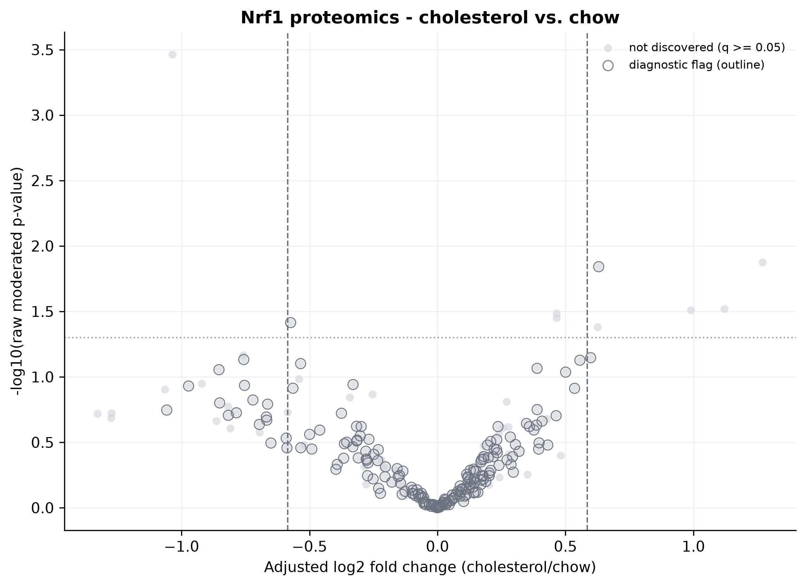

_Figure: updated volcano plot comparing cholesterol-fed mice with chow-fed control mice._ The direction of the C1q result is preserved, but C1qa, C1qb, and C1qc are no longer presented as screen-wide discoveries. The updated volcano plots contain all 252 primary proteins. The x-axis is the model-adjusted log2 fold change and the y-axis is `-log10(raw moderated p-value)`. Red and blue points are discoveries with a Benjamini-Hochberg q-value below 0.05; gray points have `q>=0.05` and are not screen-wide discoveries. A hollow outline is a diagnostic flag: the residuals showed possible non-normality by Shapiro-Wilk `p<0.05`, possible variance heterogeneity across treatment groups by Brown-Forsythe `p<0.05`, or an influential observation with Cook distance above `4/(n-p)`. A flag is not proof that an assumption failed and does not remove the protein or alter its p-value, q-value, or discovery status.

C1qa, C1qb, and C1qc have estimated cholesterol effects of 1.12, 0.99, and 1.27 log2 units, respectively. These point estimates correspond to roughly twofold increases, and their raw moderated p-values range from 0.013 to 0.031. The updated analysis therefore does not erase the original pattern.

The evidence is not strong enough for either of the two claims required of a screen-wide result:

1. After accounting for the 252 protein hypotheses with the Benjamini-Hochberg procedure, none of the C1q proteins has `q<0.05`.
2. Although each point estimate exceeds the historical 1.5-fold threshold, its 95% confidence interval extends below `log2(1.5)=0.585`. The lower confidence limits are only 0.12 for C1qa, 0.10 for C1qb, and 0.30 for C1qc. The data therefore do not establish that the true effects are at least 1.5-fold.

This distinction is why the original volcano plot looked compelling while the updated inference is cautious: observed effect size, uncertainty in that effect, and false-discovery control are now evaluated separately.

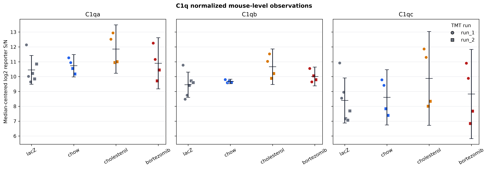

_Figure: normalized C1q observations._ Points show every mouse, marker shape identifies the TMT run, and black intervals show group means with 95% intervals. The observations show the direction and between-mouse variability behind the model estimates. These plots help show why the C1q estimates are not screen-wide significant: their intervals extend inside the threshold even though their point estimates exceed it.

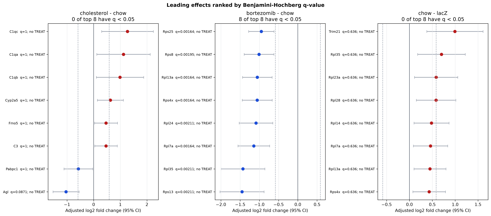

_Figure: leading effect estimates._ Points and intervals show model-adjusted log2 fold changes and 95% confidence intervals. The dashed vertical lines mark the 1.5-fold TREAT thresholds. Again here, the cholesterol panel shows why the C1q estimates do not meet this minimum-effect test: their intervals extend inside the threshold even though their point estimates exceed it.

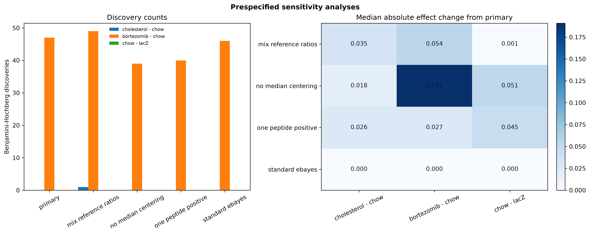

_Figure: sensitivity analyses._ Discovery counts vary with normalization and empirical Bayes settings, while median absolute changes in effect estimates remain small. Sensitivity results assess robustness; they are not used to rescue primary non-discoveries.

### Bortezomib alters the proteome

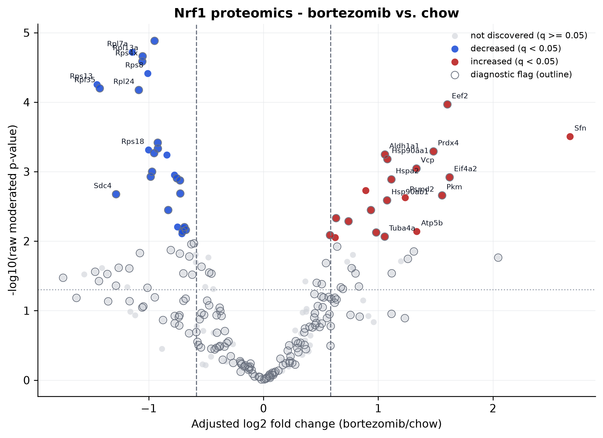

_Figure: volcano plot comparing Bortezomib-treated mice with control mice._ The positive-control response remains strong after modeling the TMT run, moderating protein-wise variances, and controlling the false discovery rate. The widespread response is expected because bortezomib inhibits the proteasome and activates Nrf1. The x-axis is the model-adjusted log2 fold change and the y-axis is `-log10(raw moderated p-value)`. Red and blue points are discoveries with a Benjamini-Hochberg q-value below 0.05; gray points have `q>=0.05` and are not screen-wide discoveries. A hollow outline is a diagnostic flag: the residuals showed possible non-normality by Shapiro-Wilk `p<0.05`, possible variance heterogeneity across treatment groups by Brown-Forsythe `p<0.05`, or an influential observation with Cook distance above `4/(n-p)`. A flag is not proof that an assumption failed and does not remove the protein or alter its p-value, q-value, or discovery status.

## Limitations

- Low and inconsistent protein pulldown with the HA tag immunoprecipitation. As a result, the proteome was basically the same with (Nrf1-HA adenovirus) or without (lacZ adenovirus) the tagged protein.
- The proteome was not significantly different with or without the HA tag, indicating issues with the HA immunoprecipitation.
- Western blot did not clearly validate the mass spectrometry findings.
- Cluster analysis in Morpheus revealed that the samples did not cluster by treatment group as expected.
- The mass spec core facility required protein to be eluted from agarose immunoprecipitation beads, and then ran the samples on gels, which introduces variability and requires a higher protein concentration than it was possible to provide in these samples. They also had a slow turnaround time, taking over two months to analyze the samples.

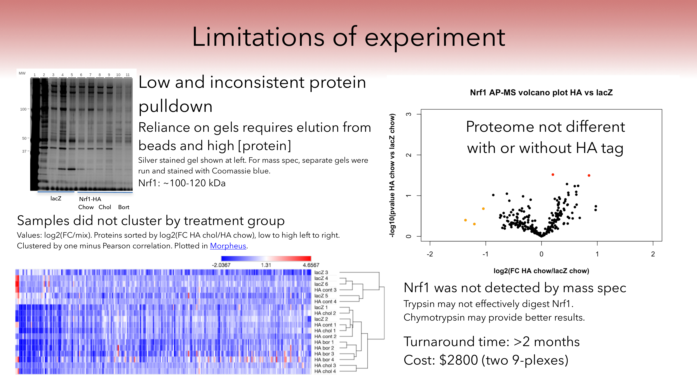

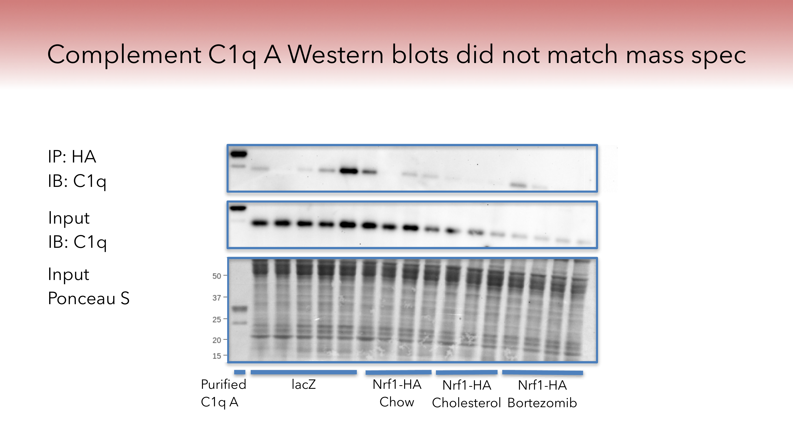

## Next steps

- Immunoprecipitation of Nrf1 directly instead of the HA tag. This would allow use of Nrf1 liver knockout mice directly without the need for adenovirus. Analysis would include livers with and without Nrf1 (Nrf1 flox Albumin Cre), with and without cholesterol diet, in order to identify cholesterol-responsive Nrf1 interacting proteins.
- Switching to a different mass spectrometry core with a quicker turnaround time that does not require protein elution from beads or running samples through gels.

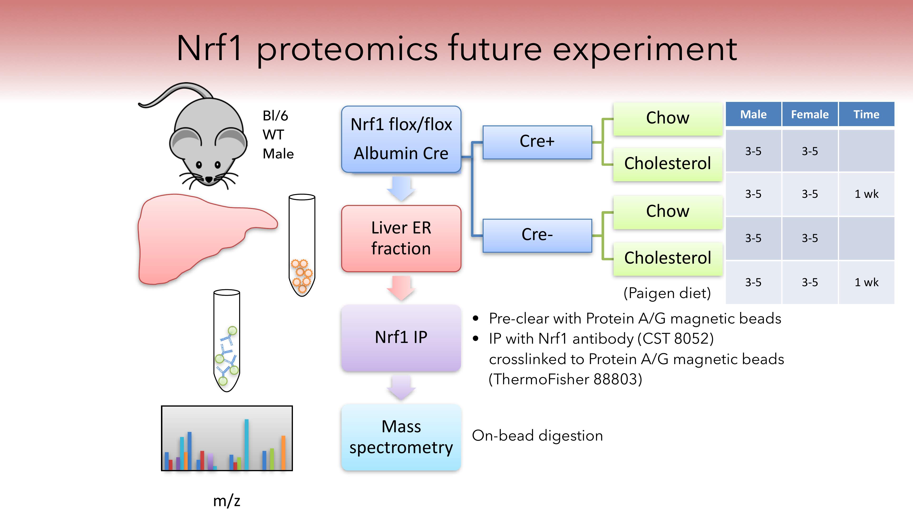

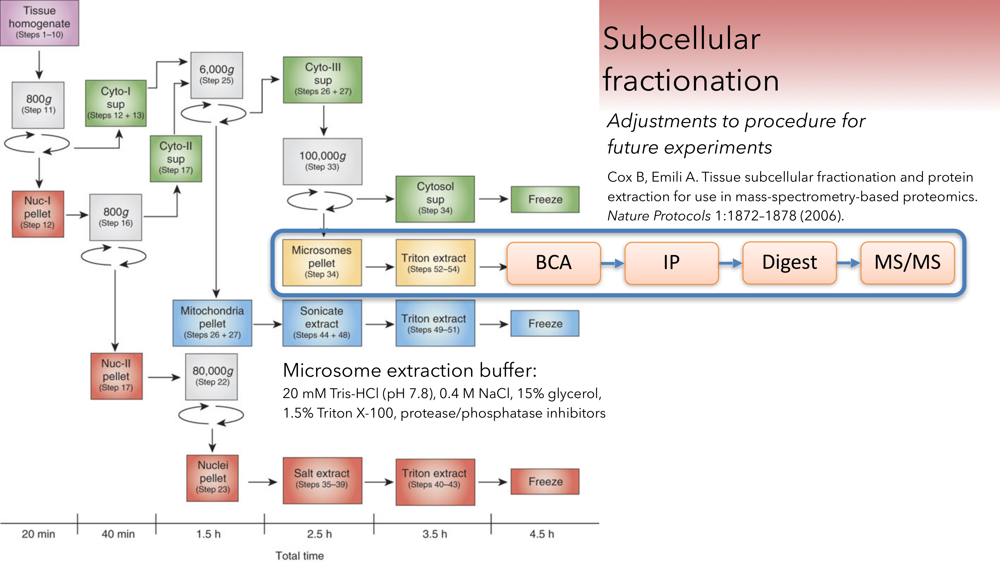

## Supplementary data

Supplementary data, including the electronic lab notebook, raw data, other data analyses, slides, and more, are available at the [supplementary data URL](./data/supplementary-data.url).

## License

This repository uses separate licenses for code and non-code content.

Code is licensed under the MIT License. See [`LICENSE-CODE`](./LICENSE-CODE).

Prose, documentation, generated figures, and other non-code creative content are licensed under the Creative Commons Attribution-ShareAlike 4.0 International Public License ([CC BY-SA 4.0](https://creativecommons.org/licenses/by-sa/4.0/)). See [`LICENSE`](./LICENSE).

Unless a file says otherwise:

- Source code, tests, configuration files, and scripts are code.
- Prose documentation, written analysis, generated figures, and other narrative or visual content are non-code creative content.
- Data files are included for analysis provenance. Repository-level licenses do not grant rights to third-party material that may be present in data files.

As described in the [GitHub Changelog](https://github.blog/changelog/2022-05-26-easily-discover-and-navigate-to-multiple-licenses-in-repositories/), GitHub uses [Licensee](https://github.com/licensee/licensee) to read license files.

[^blagoev]: Blagoev B _et al_. [Temporal analysis of phosphotyrosine-dependent signaling networks by quantitative proteomics](https://doi.org/10.1038/nbt1005). _Nature Biotechnology_ 2004.

[^bh]: Benjamini Y, Hochberg Y. [Controlling the false discovery rate: a practical and powerful approach to multiple testing](https://doi.org/10.1111/j.2517-6161.1995.tb02031.x). _Journal of the Royal Statistical Society Series B_ 1995.

[^cox]: Cox B, Emili A. [Tissue subcellular fractionation and protein extraction for use in mass-spectrometry-based proteomics](https://doi.org/10.1038/nprot.2006.273). _Nature Protocols_ 2006.

[^kammers]: Kammers K _et al_. [Detecting significant changes in protein abundance](https://doi.org/10.1002/pmic.201400392). _Proteomics_ 2015.

[^mccarthy]: McCarthy DJ, Smyth GK. [Testing significance relative to a fold-change threshold is a TREAT](https://doi.org/10.1093/bioinformatics/btp053). _Bioinformatics_ 2009.

[^oberg]: Oberg AL _et al_. [Statistical analysis of relative labeled mass spectrometry data from complex samples using ANOVA](https://doi.org/10.1021/pr700734f). _Journal of Proteome Research_ 2008.

[^smyth]: Smyth GK. [Linear models and empirical Bayes methods for assessing differential expression in microarray experiments](https://doi.org/10.2202/1544-6115.1027). _Statistical Applications in Genetics and Molecular Biology_ 2004.
